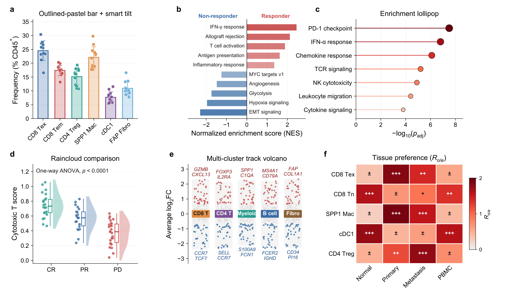
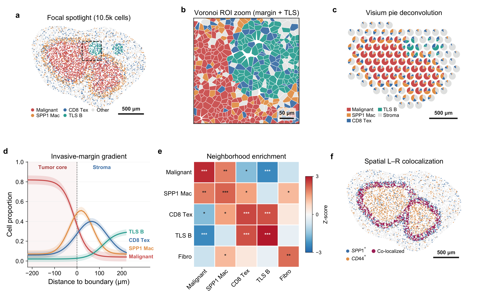
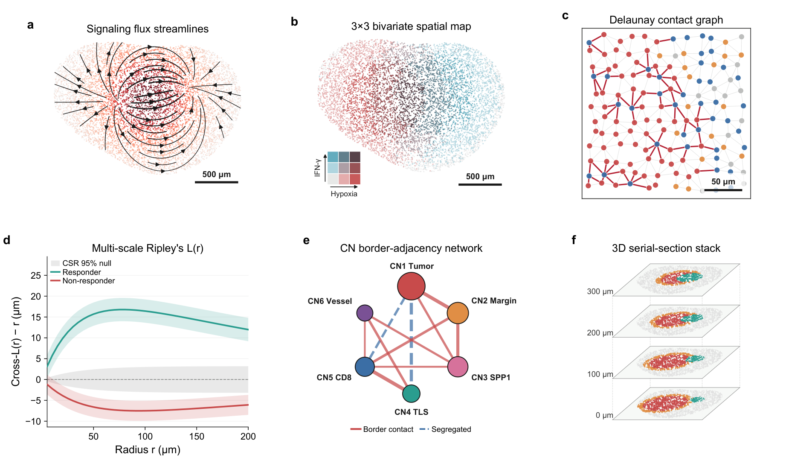
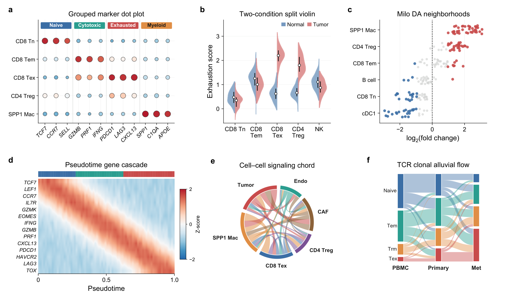
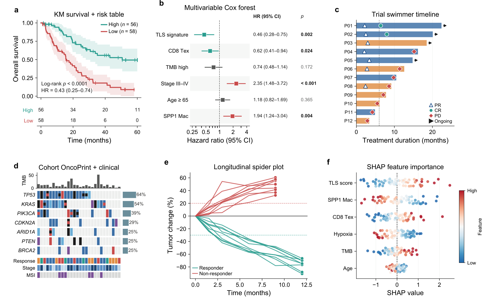
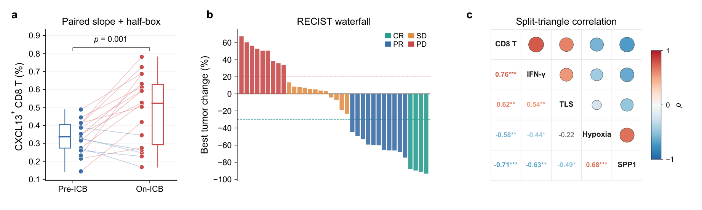
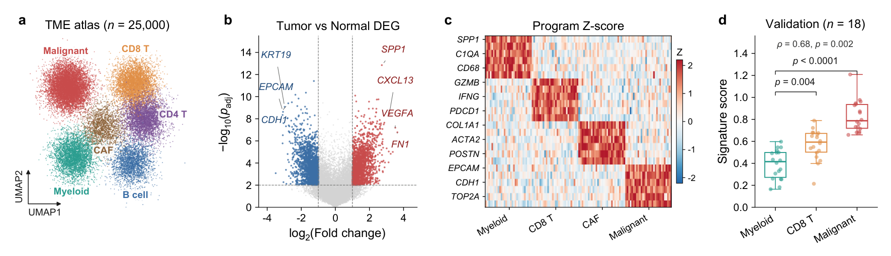
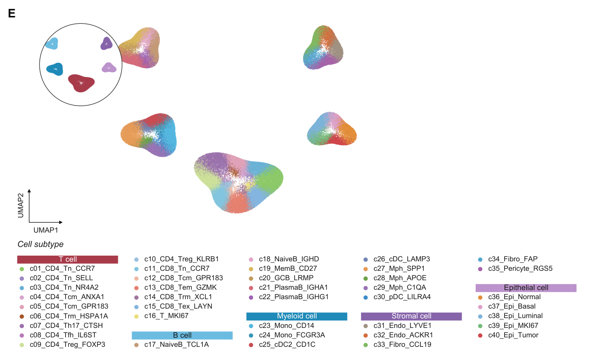
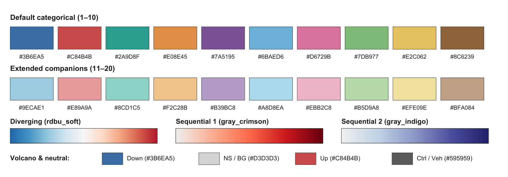

# sci-plot

An empirically distilled **Agent Skill** for generating **publication-ready scientific figures** (*Nature*, *Cell*, *Science*, *Nature Medicine*, *Cancer Cell* standard) in **Python** (`matplotlib` / `seaborn` / `scanpy`) and **R** (`ggplot2` / `ggrastr` / `ComplexHeatmap`), ready for 1:1 millimeter assembly in **Adobe Illustrator**.

Distilled quantitatively from **5,000+ high-impact original research articles** (deep vector/color/typography audit of 167 Tier-1 CNS papers + large-scale chart-choice audit of **4,968 post-2020 tumor single-cell/spatial/multi-omics papers** covering 38,306 captions and 141,092 subpanels + vector label-tilt measurement of 504 categorical x-axes across 294 Tier-1 PDFs) and 172 chart recipes.

---

## Visual Preview

### 1. Tumor-Omics High-Craft & Eye-Catching Gallery (`180 × 106 mm`, 124 KB PDF)
Dual-track upgrades beyond flat defaults: **outlined-pastel bars + smart `+45°` tilted labels**, **opposite-embedded diverging GSEA**, **enrichment lollipop**, **CNS Raincloud**, **multi-cluster track volcano**, and **Zemin Zhang $R_{o/e}$ tissue-preference matrix**.



### 2. Spatial Omics Publication Gallery (`180 × 108 mm`, 600 dpi Hybrid PDF)
Empirically distilled from **1,035 tumor spatial-omics papers**: **Focal-lineage spotlight** (10.5k cells, 600 dpi raster) + **Macro→Micro single-cell Voronoi ROI zoom**, **Visium hexagonal pie-chart deconvolution**, **signed tumor–stroma boundary gradient**, **spatial neighborhood Z-score matrix**, and **dual-channel spatial L–R colocalization** with exact physical vector scale bars.



### 3. 2025–2026 Frontier & Niche Spatial Gallery (`180 × 108 mm`, 600 dpi Hybrid PDF)
Empirically distilled from **588 2025–2026 spatial tumor papers**: **signaling flux streamlines (`COMMOT`/`Spateo`)**, **3×3 bivariate choropleth spatial co-expression**, **Delaunay single-cell physical contact mesh**, **multi-scale Ripley's / Besag's `L(r) − r` curve + CSR envelope**, **cellular neighborhood (`CN`) border-adjacency network**, and **2.5D isometric 3D serial-section tissue stack**.



### 4. Single-Cell & Immune Repertoire Gallery (`180 × 108 mm`, 600 dpi Hybrid PDF)
Empirically distilled from **747 Tier-1 2025–2026 tumor papers**: **grouped marker dot plot** (top module brackets + dark rims), **two-condition split violin**, **Milo DA beeswarm**, **smoothed pseudotime gene-cascade heatmap**, **cell–cell communication chord diagram**, and **longitudinal TCR clonal alluvial flow**.



### 5. Clinical Cohort, Oncology Trial, Survival & ML Gallery (`180 × 112 mm`, Vector PDF)
**Kaplan–Meier + exact aligned Number-at-Risk table**, **multivariable Cox forest plot**, **oncology swimmer timeline**, **multi-track clinical OncoPrint** (TMB + split double-hits + `%` + clinical metadata strips), **longitudinal spider plot**, and **SHAP interpretability beeswarm**.



### 6. Clinical & Correlation Upgrades (`180 × 54 mm`, 66 KB PDF)
**Paired Pre/Post longitudinal slope + half-box**, **oncology RECIST waterfall**, and **split-triangle correlation matrix**.



### 3. Single-Row 4-Panel Hybrid Vector + Raster Figure (`180 × 52 mm`, 503 KB PDF)
600 dpi rasterized data layers (25k-cell UMAP, 15k-gene Volcano, 2,880-cell Heatmap) + 100% live editable Arial vector axes, ticks, gene labels, and boxplot.



### 2. Multi-Subcluster Atlas UMAP Composite (`160 × 95 mm`, 651 KB PDF)
600 dpi cohesive subcluster UMAP + circular major-lineage inset + equal-length vector L-axes + tight multi-column vector legend with colored lineage banners — all in one PDF (zero manual stitching).



### 3. Empirically #1 Default CNS Color System
Auto-activated on import/source (`Blue` & `Red` present in 100% of audited Tier-1 papers, followed by `Teal/Sage`, `Amber`, `Plum`).



---

## Key Features

- **1:1 Print Scale in Millimeters**: Sized directly to *Nature* (`89 / 120 / 180 mm`), *Cell* (`85 / 114 / 174 mm`), and *Science* (`57 / 121 / 184 mm`) grids with empirically measured subpanel aspect ratios so 3–5 crisp panels fit cleanly in one row.
- **Locked Default `cns_compact` Typography**: Editable TrueType **Arial** — Panel letters `8 pt bold` (Cell `9 pt`), axis/panel titles `7 pt`, ticks/legends/stats `6 pt`, dense heatmap/dotplot genes `5–5.5 pt`, axis strokes `0.40 pt`, ticks `2.0 pt`. Also includes `cell_standard` and `arial_8pt` presets.
- **Statistical Symbols, Italic Greek & Rigorous Tests**:
  - Built-in formatters (`fmt_p`, `fmt_q`, `fmt_corr`, `fmt_n`, `fmt_greek`, `fmt_log2fc`, `fmt_neglog10p`) enforcing lowercase italic *p*, *q*, *r*, *n*, *ρ*, *α*, *β*, *γ*, *μ* with exact spacing (`p = 0.004`, `ρ = 0.68, p = 0.002`).
  - Built-in two-sided `auto_stat_test()` / `auto_corr_test()` with normality checks, BH FDR multiple-testing correction, paired/unpaired routing, and single-cell pseudoreplication warnings.
- **Hybrid Vector + 600 dpi Raster Export**: Auto-rasterizes dense layers (`> 2,000` scatter points or `> 2,500` heatmap cells) at 600 dpi while preserving all axes, ticks, text, and legends as live vector objects.
- **Adobe Illustrator Anti-Fragmentation Toolkit**:
  - Python `coalesce_pdf_text_runs()` collapses matplotlib mathtext `Td` splits and optical `TJ` kerning splits into single PDF text lines (`verify_ai_pdf()` gate).
  - Native Illustrator script [`scripts/MergeSciPlotText.jsx`](scripts/MergeSciPlotText.jsx) merges remaining PDF subscript (`Ts`) and multi-style fragments inside Illustrator into single-line `PointText` objects (supporting 0° horizontal and ±90° vertical y-axes).
- **Two-Tier Cloudy UMAP**: Direct same-color cluster labeling for ≤ 12 clusters (`plot_cloudy_umap`) and circular major-inset + grouped banner legend for 15–100 subclusters (`plot_atlas_umap_composite`), with exact equal-length L-axes.
- **Concise Axis Labels & CNS Micro-Aesthetics**: Empirical 1–3 word Sentence-case axis rules, zero-gap bar baselines, bar/group spacing (`CNS_SPEC`), hollow boxplots, Z-score `[-2, +2]` clipping, and biological italicization rules.

---

## Repository Structure

```text
sci-plot/
├── SKILL.md                               # Main agent skill specification
├── README.md
├── references/
│   ├── chart-selector.md                  # Data-to-chart decision matrix
│   ├── sizing-and-aspect-ratios.md        # Journal grids, mm dimensions, W:H ratios, visual Hero zones & anti-sparse rules
│   ├── journal-figure-standards.md        # Cross-journal artwork matrix (Nature/NCB/Nat Med/Cell/Science/AACR) & 6 Anti-Sparse Density Laws
│   ├── color-architecture.md              # Single-figure & whole-manuscript palettes
│   ├── axis-labels-and-annotations.md     # Concise CNS axis-label copywriting dictionary
│   ├── micro-aesthetics.md                # Bar spacing, box/point sizes, alpha, stroke hierarchy
│   ├── statistical-tests.md               # Two-sided test selection & anti-pseudoreplication guide
│   ├── spatial-omics-visualization.md     # Visium/Xenium/CosMx/CODEX/IMC/mIF spatial playbook (1,035 papers)
│   ├── single-cell-and-repertoire.md      # Single-cell, Milo, DotPlot, pseudotime, Chord & TCR repertoire playbook
│   ├── clinical-and-oncology-charts.md    # Clinical OncoPrint, KM+risk table, Cox forest, Swimmer, Spider, SHAP & UpSet
│   └── hybrid-vector-raster-ai.md         # Python/R 600-dpi hybrid export & AI editability cookbook
├── scripts/
│   ├── sci_plot_py.py                     # Python (matplotlib/seaborn/scanpy) publication kit + CLI
│   ├── sci_plot_r.R                       # R (ggplot2/ggrastr/ComplexHeatmap) publication kit
│   └── MergeSciPlotText.jsx               # Adobe Illustrator one-click single-line text merger
└── assets/                                # Preview figures
```

---

## Installation as an Agent Skill

### Option 1: Direct Clone (Antigravity / Claude Code / Cursor / Codex)

```bash
# Global install for Antigravity
git clone https://github.com/chenwh1993/sci-plot.git ~/.gemini/config/skills/sci-plot

# Or project-level install inside any workspace
git clone https://github.com/chenwh1993/sci-plot.git .agents/skills/sci-plot
```

### Option 2: External Directory Mount (`skills.json`, Antigravity)
Keep the cloned folder anywhere (e.g. `D:/skills/sci-plot`) and register its parent folder in `~/.gemini/config/skills.json`:

```json
{
  "entries": [
    { "path": "D:/skills" }
  ]
}
```

### Quick Code Usage

**Python**
```python
import sci_plot_py as sp

sp.apply_cns_style("cns_compact")           # Arial 6-7pt + default CNS palette + rdbu_soft
stat = sp.auto_stat_test([ctrl, treat])     # Two-sided test + formatted lowercase italic p
fig = sp.new_cns_figure(width_mm=56, height_mm=44)
# ... plot with rasterized=True on dense scatter/heatmap layers ...
sp.save_ai_figure(fig, "out/fig1a", raster_dpi=600, coalesce_text=True)
print(sp.verify_ai_pdf("out/fig1a.pdf"))
```

**R**
```r
source("scripts/sci_plot_r.R")              # Activates default CNS palette + theme_cns()
p <- plot_atlas_umap_composite(umap_df, major_colors = pal_maj, sub_colors = pal_sub)
save_ai_pdf(p, "out/fig1e_atlas", width_mm = 160, height_mm = 95)
```

**Adobe Illustrator (Optional 1-Click Subscript/Multi-Style Merger)**
- Open any Python or R PDF in Illustrator → `File → Scripts → Other Script...` (`Ctrl + F12`) → select [`scripts/MergeSciPlotText.jsx`](scripts/MergeSciPlotText.jsx).

---

## License

MIT License
